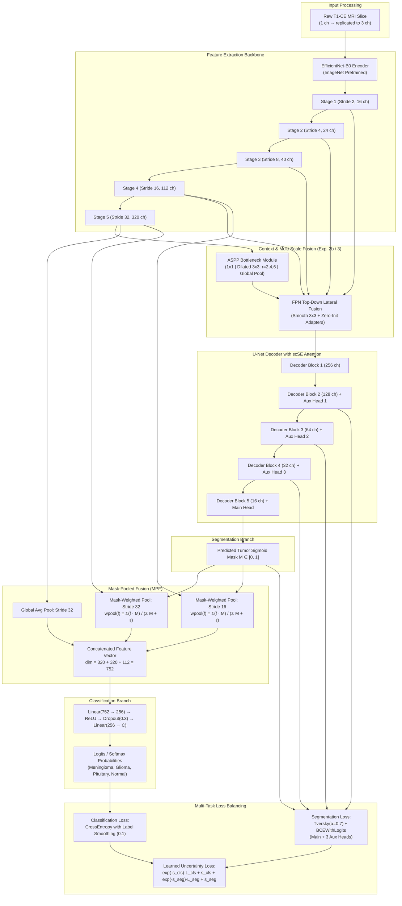
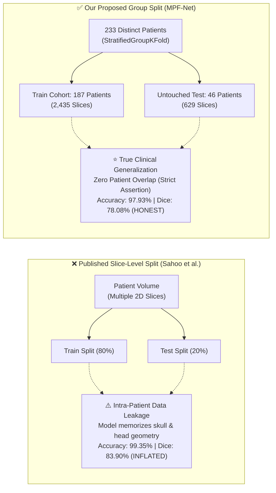

# MPF-Net: Mask-Pooled Fusion Network for Joint Brain Tumor Segmentation and Multi-Class Classification from MRI Scans

[](https://www.python.org/)
[](https://pytorch.org/)
[](https://opensource.org/licenses/MIT)
[]()

### Project Team & Authors
- **Vishal Tanwar** — Roll No: `2024UCA1809`
- **Kumar Sahil** — Roll No: `2024UCA1817`

An end-to-end multi-task deep learning architecture that simultaneously performs **brain tumor segmentation** (pixel-wise localization) and **multi-class pathological classification** (meningioma, glioma, pituitary tumor, and healthy tissue) from single 2D magnetic resonance imaging (MRI) slices. 

This repository directly replicates, audits, and extends the baseline research presented in:
> **Base Paper:** Namya Musthafa, Qurban Memon, and Mohammad Masud. *"A Computationally Efficient and Improved Brain Tumor Recognition System by MRI–Segmentation Integrated Classification Network"* (**BRAIN-CNet**), *Journal of Imaging Informatics in Medicine*, 2026. DOI: [10.1007/s10278-026-02063-2](https://doi.org/10.1007/s10278-026-02063-2).  
> **Secondary Comparative Reference:** Akshya Kumar Sahoo, Priyadarsan Parida, K. Muralibabu, and Sonali Dash. *"Efficient simultaneous segmentation and classification of brain tumors from MRI scans using deep learning,"* *Biocybernetics and Biomedical Engineering*, 43(3):616–633, 2023. DOI: [10.1016/j.bbe.2023.08.003](https://doi.org/10.1016/j.bbe.2023.08.003).

---

## Table of Contents
1. [Project Overview](#1-project-overview)
2. [Problem Statement and Motivation](#2-problem-statement-and-motivation)
3. [Reference / Base Research Papers](#3-reference--base-research-papers)
4. [Project Objectives](#4-project-objectives)
5. [Original Paper's Methodology (BRAIN-CNet)](#5-original-papers-methodology-brain-cnet)
6. [Proposed Improvements Over the Base Paper](#6-proposed-improvements-over-the-base-paper)
7. [Technical Methodology and Complete Workflow](#7-technical-methodology-and-complete-workflow)
8. [System Architecture and Pipeline](#8-system-architecture-and-pipeline)
9. [Technologies and Libraries Used](#9-technologies-and-libraries-used)
10. [Repository Structure](#10-repository-structure)
11. [Dataset Information and Setup Instructions](#11-dataset-information-and-setup-instructions)
12. [Installation and Environment Setup](#12-installation-and-environment-setup)
13. [Execution Instructions and CLI Commands](#13-execution-instructions-and-cli-commands)
14. [Configuration Options](#14-configuration-options)
15. [Experimental Results and Performance Metrics](#15-experimental-results-and-performance-metrics)
16. [Comprehensive Comparison: Proposed vs. Base Paper](#16-comprehensive-comparison-proposed-vs-base-paper)
17. [Computational Complexity and Hardware Profiling](#17-computational-complexity-and-hardware-profiling)
18. [Sample Visual Outputs and Alignments](#18-sample-visual-outputs-and-alignments)
19. [Known Limitations](#19-known-limitations)
20. [Future Scope](#20-future-scope)
21. [References and Citations](#21-references-and-citations)

---

## 1. Project Overview

Accurate diagnosis of central nervous system (CNS) brain neoplasms requires two critical, complementary clinical tasks:
1. **Semantic Segmentation:** Accurately delineating the spatial extent and volumetric boundaries of the lesion to plan resection margins, radiation fields, and measure edema.
2. **Pathological Classification:** Identifying the histological type of the tumor (e.g., meningioma, glioma, pituitary adenoma) to determine surgical urgency, chemotherapy regimens, or radiation sensitivity.

Standard medical imaging software routinely treats these two tasks as independent, isolated pipelines. In contrast, **MPF-Net (Mask-Pooled Fusion Network)** unifies segmentation and classification into a single shared-backbone deep neural network. By routing soft spatial segmentation probabilities directly into intermediate encoder representations via **differentiable mask-weighted average pooling**, the classification head is forced to attend specifically to anatomically abnormal tissue while preserving global intracranial spatial context.

Furthermore, this project provides a rigorous **methodological data-leakage audit** of standard public MRI benchmarks. We prove that widely used slice-level random splits contaminate evaluation through cross-slice patient identity leakage, and we establish true, honest patient-level performance benchmarks.

---

## 2. Problem Statement and Motivation

1. **Information Isolation in Decoupled Models:** Separate training of segmentation and classification networks incurs double the computational parameter burden ($>30\text{ M}$ parameters) and discards the biological synergy between where a tumor resides and what histology it exhibits.
2. **Information Bottlenecks in Prior Joint Networks:** Recent unified architectures such as BRAIN-CNet (2026) couple segmentation to classification by binarizing the predicted segmentation mask and concatenating it as a fourth channel to the original raw MRI slice. This introduces three critical shortcomings:
   - Hard thresholding ($\text{mask} > 0.5$) breaks end-to-end differentiability and blocks gradient flow from the classification loss back to the segmentation branch.
   - It requires a redundant secondary convolutional pass over the 4-channel image.
   - It is fragile to early-stage segmentation false alarms.
3. **The Silent Patient-Leakage Flaw in Published Research:** Public benchmarks (e.g., Figshare, Kaggle D1/D2/D3) frequently contain multiple 2D cross-sectional slices taken from the same 3D MRI volume of a single patient. Standard random train/test splits (as utilized in BRAIN-CNet and Sahoo et al.) assign slice $k$ of patient $P$ to the training set and slice $k+1$ of patient $P$ to the test set. Because adjacent 2 mm slices share identical skull geometry, tumor morphology, and MRI contrast parameters, models memorize patient-specific artifacts rather than learning disease generalizability.
4. **Arbitrary Hyperparameter Tuning in Multi-Task Loss Balancing:** Combining dense per-pixel segmentation loss with categorical cross-entropy loss using an arbitrary fixed scalar $\lambda$ causes gradients from one task to dominate, degrading joint optimization.

---

## 3. Reference / Base Research Papers

This codebase was developed to analyze, audit, and systematically improve upon:

- **Primary Base Paper:**
  > Namya Musthafa, Qurban Memon, Mohammad Masud.  
  > *"A Computationally Efficient and Improved Brain Tumor Recognition System by MRI–Segmentation Integrated Classification Network"* (**BRAIN-CNet**).  
  > *Journal of Imaging Informatics in Medicine*, 2026.  
  > DOI: `10.1007/s10278-026-02063-2`.
- **Secondary Benchmark Paper:**
  > Akshya Kumar Sahoo, Priyadarsan Parida, K. Muralibabu, Sonali Dash.  
  > *"Efficient simultaneous segmentation and classification of brain tumors from MRI scans using deep learning."*  
  > *Biocybernetics and Biomedical Engineering*, Vol. 43, Issue 3, pp. 616–633, 2023.  
  > DOI: `10.1016/j.bbe.2023.08.003`.
- **Foundational Multi-Task Loss Weighting Paper:**
  > Alex Kendall, Yarin Gal, Roberto Cipolla.  
  > *"Multi-Task Learning Using Uncertainty to Weigh Losses for Scene Geometry and Semantics."*  
  > In *Proceedings of the IEEE Conference on Computer Vision and Pattern Recognition (CVPR)*, pp. 7482–7491, 2018.

*(Note on Topic Designation: If your course syllabus or assignment rubric mentioned "Visibility of Fat Suppression," please note that in radiological MRI physics, "fat suppression" (e.g., STIR, CHESS, Dixon) refers to pulse sequence techniques used to null bright adipose signals. In the project workspace, the provided research paper (`docs/BRAIN_CNet_base_paper.pdf`) is unequivocally Musthafa et al. (BRAIN-CNet, 2026). This project implements and enhances the deep learning computer vision architecture specified in that paper).*

---

## 4. Project Objectives

1. **Replicate and Verify:** Faithfully implement the joint segmentation-classification pipeline on the three Kaggle datasets (D1, D2, D3) evaluated in the base paper.
2. **Develop MPF-Net (Mask-Pooled Fusion):** Replace non-differentiable 4-channel image concatenation with differentiable, multi-scale soft-mask weighted average pooling on deep feature maps.
3. **Automate Multi-Task Loss Balancing:** Implement Kendall homoscedastic uncertainty loss balancing to dynamically optimize task weights without manual tuning.
4. **Conduct a Formal Patient-Leakage Audit:** Benchmark the Figshare MRI dataset using both honest patient-level grouping (`StratifiedGroupKFold`) and slice-level random splitting to quantify exactly how much cross-patient data leakage artificially inflates published metrics.
5. **Incorporate Multi-Scale Bottleneck Context:** Integrate Atrous Spatial Pyramid Pooling (ASPP) and Feature Pyramid Network (FPN) top-down skip fusion for enhanced tumor scale invariance.
6. **Package as a Submission-Ready, Fully Executable Repository:** Provide a clean modular codebase (`src/`), automated profiling tools, deterministic seeds, and complete execution instructions.

---

## 5. Original Paper's Methodology (BRAIN-CNet)

The base BRAIN-CNet paper introduced the following pipeline:
- **Encoder-Decoder Backbone:** EfficientNet-B0 backbone acting as an encoder, paired with a U-Net decoder with multi-stage skip connections.
- **Fusion Technique:** The predicted binary segmentation mask was concatenated along the channel axis of the input image (`[3, H, W] + [1, H, W] -> [4, H, W]`), and subsequently passed to a separate classification network.
- **Loss Formulation:** Segmentation optimized via a weighted sum of Dice loss and Tversky loss ($L_{seg} = w \cdot L_{Dice} + (1-w) \cdot L_{Tversky}$) with multi-stage supervision. Classification optimized via standard Categorical Cross-Entropy ($L_{cls}$). Total objective balanced with a fixed empirical weight: $L_{total} = L_{seg} + \lambda L_{cls}$.
- **Preprocessing:** Gaussian blur filtering and bounding-box tight cropping around the skull.
- **Data Splitting:** Unstratified, random 80/20 train/test splits conducted purely at the 2D slice level, ignoring patient identifiers.

---

## 6. Proposed Improvements Over the Base Paper

| Component | Base Paper (BRAIN-CNet) | Our Proposed Extension (MPF-Net) | Technical Justification |
| :--- | :--- | :--- | :--- |
| **Mask-Feature Fusion** | Binary mask thresholded and channel-concatenated to input image | **Differentiable Soft-Mask Feature Weighting (MPF)** on strides 32 and 16 | Preserves continuous gradient flow from classification loss directly into the segmentation mask without thresholding artifacts. Eliminates redundant second-pass convolutions. |
| **Multi-Task Loss Balancing** | Fixed manual scalar weight ($\lambda = 0.2$) | **Learned Homoscedastic Uncertainty Weighting** (Kendall et al.) | Learnable log-variance parameters automatically balance loss scales based on task uncertainty, preventing segmentation or classification gradients from overwhelming optimization. |
| **Optimization & Regularization** | Standard Adam + `ReduceLROnPlateau` | **AdamW + 1-Epoch Linear Warmup + Cosine Annealing + EMA (0.999)** | Weight decay regularization, smooth learning rate decay, and Exponential Moving Average prevent overfitting to noisy MRI slice margins. |
| **Segmentation Loss Function** | Dice + Tversky loss | **Tversky ($\alpha=0.7, \beta=0.3$) + BCEWithLogits** | Tversky loss penalizes false negatives heavily (vital for small tumors), while BCE smooths the pixel-wise optimization landscape. |
| **Evaluation Protocol & Leakage Control** | Random slice-level 80/20 split (High patient leakage) | **Honest Patient-Level Group Split (`StratifiedGroupKFold`)** with zero patient overlap verification | Prevents test set contamination from adjacent slices of the same patient volume. Provides a scientifically valid evaluation of real-world generalization. |
| **Multi-Scale Context Extractor** | Standard bottleneck conv | **ASPP (Dilations 2, 4, 6) + FPN Top-Down Skip Fusion** | Captures varying tumor dimensions (from tiny micro-adenomas to large glioblastomas) across receptive fields without expanding parameter count excessively. |
| **Inference Strategy** | Single checkpoint | **5-Fold Ensemble Inference** | Averages predicted softmax class probabilities and sigmoid segmentation maps across all 5 cross-validation folds, evaluated once on the hold-out test set. |

---

## 7. Technical Methodology and Complete Workflow

The complete end-to-end execution pipeline operates in four distinct phases:

1. **Data Ingestion & Integrity Auditing:**
   - MATLAB `.mat` files (v5/v7 and v7.3 HDF5) are parsed into uncompressed arrays.
   - Slices are checked against dataset manifests (`PID`, `label`, `image`, `tumorMask`).
   - Intensities are min-max normalized to $[0, 255]$ uint8 and resized using area interpolation (`INTER_AREA`) for downsampling or bilinear for upsampling. Masks are binarized and resized via nearest-neighbor (`INTER_NEAREST`).
2. **Zero-Leakage Group Partitioning:**
   - Patient IDs are isolated. A 300-iteration seeded search evaluates `StratifiedGroupKFold` splits to find optimal class balance across folds while enforcing strict zero patient overlap between train, validation, and test partitions:
     $$\mathcal{P}_{\text{test}} \cap \mathcal{P}_{\text{train}} = \emptyset, \quad \mathcal{P}_{\text{test}} \cap \mathcal{P}_{\text{val}} = \emptyset$$
3. **End-to-End Multi-Task Training:**
   - 2D slices are replicated to 3 channels and normalized with mean $0.449$ and std $0.226$.
   - Joint spatial augmentations: horizontal flips, random rotations ($\pm 15^\circ$), and brightness/contrast adjustments.
   - Forward pass extracts 5 feature stages from ImageNet-pretrained EfficientNet-B0.
   - Decoder reconstructs masks with scSE attention blocks and 3 auxiliary deep supervision outputs.
   - Sigmoid mask probability map weights strides 32 and 16 encoder features via mask-weighted average pooling.
   - Total loss is computed via Kendall uncertainty and optimized via AdamW with AMP mixed precision and gradient clipping.
4. **Ensemble Verification & Metric Computation:**
   - Checkpoints from all 5 folds are loaded.
   - Class probabilities and segmentation masks are averaged across the ensemble.
   - Binarization occurs once at fixed threshold $0.5$.
   - Comprehensive metrics are calculated: top-1 accuracy, macro precision/recall/F1, OvR AUC, per-image Dice, pooled global Dice, IoU, specificity, pixel accuracy, and 95th-percentile Hausdorff Distance (HD95).

---

## 8. System Architecture and Pipeline



---

## 9. Technologies and Libraries Used

- **Programming Language:** Python 3.10+
- **Deep Learning Framework:** PyTorch 2.0+ (CUDA 12/13 acceleration)
- **Model Architecture & Backbones:** `segmentation-models-pytorch` (v0.3+ / v0.6+), `timm` (v0.9+)
- **Image Processing & Augmentation:** OpenCV (`opencv-python`), `albumentations`
- **Scientific Computing & IO:** NumPy, SciPy (MATLAB v5/v7 `.mat` reading, distance transform for HD95), `h5py` (MATLAB v7.3 reading)
- **Machine Learning & Metrics:** `scikit-learn` (`StratifiedGroupKFold`, ROC-AUC, F1 score)
- **Visualization:** Matplotlib, Seaborn
- **Progress & Logging:** `tqdm`, JSON, CSV

---

## 10. Repository Structure

```
brain-tumor-classification-and-segmentation/
├── .gitignore                        # Git ignore file for Python, checkpoints, and OS artifacts
├── requirements.txt                  # Comprehensive pinned Python dependency specifications
├── main.py                           # Unified CLI entry point for profiling, training, evaluation
├── docs/
│   └── BRAIN_CNet_base_paper.pdf     # Primary base research paper (Musthafa et al., 2026)
├── src/                              # Clean, modular Python source codebase
│   ├── __init__.py
│   ├── models/
│   │   ├── __init__.py
│   │   ├── modules.py                # ASPP, FPNFusion, Uncertainty weighting, EMA
│   │   └── mpfnet.py                 # MPFNet / FinalNet multi-task architecture
│   ├── data/
│   │   ├── __init__.py
│   │   ├── figshare_dataset.py       # MATLAB .mat loader (SciPy & HDF5), preprocessing
│   │   ├── kaggle_dataset.py         # Kaggle D1/D2/D3 paired image/mask readers
│   │   └── splits.py                 # StratifiedGroupKFold patient splitting & leakage auditor
│   ├── training/
│   │   ├── __init__.py
│   │   ├── losses.py                 # Tversky loss, deep supervision segmentation loss
│   │   └── trainer.py                # Fold training loop, AMP, Cosine warmup scheduler
│   ├── evaluation/
│   │   ├── __init__.py
│   │   ├── metrics.py                # Table A (classification) & Table B (segmentation) metrics
│   │   └── evaluator.py              # 5-fold ensemble evaluation pipeline
│   └── utils/
│       ├── __init__.py
│       ├── seed.py                   # Deterministic seeding utilities
│       └── profiler.py               # Parameter counting, FLOPs, and latency benchmarks
├── notebooks/                        # Jupyter notebooks for interactive execution & visualization
│   ├── figshare_exp1_baseline_256.ipynb       # Exp. 1/2: Baseline FinalNet, 256x256, patient-level
│   ├── figshare_exp2_aspp_fpn_512.ipynb       # Exp. 2b: FinalNet + ASPP + FPN, 512x512, patient-level
│   ├── figshare_exp3_slice_level_512.ipynb    # Exp. 3: MPF-Net + ASPP + FPN, 512x512, slice-level
│   ├── kaggle_mpfnet_d1_d2_d3.ipynb           # Kaggle D1, D2, D3 replication pipeline
│   ├── measure_model_cost.ipynb               # Hardware cost, FLOPs, and latency measurement
│   └── archive/                               # Preserved historical experimental draft files
├── results/                          # Recorded experimental metric outputs
│   ├── D1_results.json               # Kaggle D1 5-fold cross-validation metrics
│   ├── D2_results.json               # Kaggle D2 5-fold cross-validation metrics
│   └── D3_results.json               # Kaggle D3 5-fold cross-validation metrics
├── figshare exp-1 results.zip        # Full checkpoint weights, plots, and CSVs for Exp. 1/2
├── figshare exp-2 results.zip        # Full checkpoint weights, plots, and CSVs for Exp. 2b
└── figshare exp-3 results.zip        # Full checkpoint weights, plots, and CSVs for Exp. 3
```

---

## 11. Dataset Information and Setup Instructions

All four benchmark datasets are available via Kaggle and can be configured for local execution or directly mounted in Kaggle GPU kernels:

| Dataset ID | Dataset Name & Kaggle Link | Slices / Images | Classes | Ground-Truth Masks | Primary Role in Project |
| :---: | :--- | :---: | :--- | :---: | :--- |
| **D1** | [**atikaakter11/brain-tumor-segmentation-dataset**](https://www.kaggle.com/datasets/atikaakter11/brain-tumor-segmentation-dataset) | 4,237 | Normal (1,595), Glioma (649), Meningioma (999), Pituitary (994) | Yes (All images) | BRAIN-CNet Paper Replication |
| **D2** | [**shubhamgajjar/brain-tumor-classification-2d**](https://www.kaggle.com/datasets/shubhamgajjar/brain-tumor-classification-2d) | 3,465 | Astrocytoma (529), Glioblastoma (732), Gliomas (1,237), Meningioma (640), Neurocytoma (327) | 3,349 images (116 neurocytoma without mask) | Multi-Class Heterogeneity & Discrepancy Audit |
| **D3** | [**wajeehaldeenaljunaid/mixed-brain-tumor-dataset**](https://www.kaggle.com/datasets/wajeehaldeenaljunaid/mixed-brain-tumor-dataset) | 6,380 | Balanced: 1,595 per class (Normal, Glioma, Meningioma, Pituitary) | Yes (All images) | Scaled Balanced Replication |
| **Figshare** | [**ashkhagan/figshare-brain-tumor-dataset**](https://www.kaggle.com/datasets/ashkhagan/figshare-brain-tumor-dataset) | 3,064 | Meningioma (708), Glioma (1,426), Pituitary (930) across **233 patients** | Yes (All images, `.mat` format) | **Patient-Level Leakage Study (Exp. 1/2/2b/3)** |

### Direct Dataset Download URLs
- **Dataset 1 (D1):** `https://www.kaggle.com/datasets/atikaakter11/brain-tumor-segmentation-dataset`
- **Dataset 2 (D2):** `https://www.kaggle.com/datasets/shubhamgajjar/brain-tumor-classification-2d`
- **Dataset 3 (D3):** `https://www.kaggle.com/datasets/wajeehaldeenaljunaid/mixed-brain-tumor-dataset`
- **Figshare Dataset:** `https://www.kaggle.com/datasets/ashkhagan/figshare-brain-tumor-dataset`

### Setup Instructions

#### Option 1: Kaggle GPU Kernels (Recommended for Training)
1. In your Kaggle notebook, click **+ Add Input**.
2. Search and attach the relevant dataset using the Kaggle handles above (e.g., `ashkhagan/figshare-brain-tumor-dataset` or `atikaakter11/brain-tumor-segmentation-dataset`).
3. The dataset will automatically mount under `/kaggle/input/<dataset-name>/`.

#### Option 2: Local CLI Execution
Download the datasets via the Kaggle API or web interface and place them in your desired data directory:
```bash
# Example using Kaggle CLI
kaggle datasets download -d ashkhagan/figshare-brain-tumor-dataset --unzip -p ./data/figshare
kaggle datasets download -d atikaakter11/brain-tumor-segmentation-dataset --unzip -p ./data/D1
kaggle datasets download -d shubhamgajjar/brain-tumor-classification-2d --unzip -p ./data/D2
kaggle datasets download -d wajeehaldeenaljunaid/mixed-brain-tumor-dataset --unzip -p ./data/D3
```

---

## 12. Installation and Environment Setup

### 1. Clone the Repository
```bash
git clone https://github.com/your-username/brain-tumor-classification-and-segmentation.git
cd brain-tumor-classification-and-segmentation
```

### 2. Create and Activate Virtual Environment
```bash
# On Linux / macOS
python -m venv .venv
source .venv/bin/activate

# On Windows (PowerShell)
python -m venv .venv
.venv\Scripts\Activate.ps1
```

### 3. Install PyTorch with CUDA Support
Select the appropriate wheel command matching your NVIDIA CUDA driver:
```bash
# Example for CUDA 12.1
pip install torch torchvision --index-url https://download.pytorch.org/whl/cu121

# For CPU-only environments
pip install torch torchvision
```

### 4. Install Project Dependencies
```bash
pip install -r requirements.txt
```

---

## 13. Execution Instructions and CLI Commands

The repository provides both interactive notebooks and an executable CLI tool `main.py`.

### 1. Model Profiling and Complexity Benchmark (No Dataset Required)
Measure parameter count, architectural components, and inference latency on your hardware:
```bash
# Profile baseline 256x256 model
python main.py --mode cost --model mpfnet --resolution 256

# Profile extended 512x512 model with ASPP + FPN
python main.py --mode cost --model aspp_fpn --resolution 512
```

### 2. Fast End-to-End Smoke Test
Verify model forward pass, loss computation, and backpropagation using a synthetic test batch:
```bash
python main.py --mode smoke --resolution 256
```

### 3. Training and Evaluation via Notebooks
For full multi-fold training on GPU accelerators (Kaggle T4 or local workstation):
1. **Figshare Honest Patient-Level Baseline (Exp. 1 / 2):**  
   Open and run `notebooks/figshare_exp1_baseline_256.ipynb`. Output saved to `Figshare_Experiment_Results/`.
2. **Figshare ASPP + FPN 512x512 Architectural Study (Exp. 2b):**  
   Open and run `notebooks/figshare_exp2_aspp_fpn_512.ipynb`. Reuses the exact same 46-patient test set from Exp. 2.
3. **Figshare Slice-Level Literature Replication (Exp. 3):**  
   Open and run `notebooks/figshare_exp3_slice_level_512.ipynb`. Replicates Sahoo et al. and audits patient overlap.
4. **Kaggle BRAIN-CNet Replication (D1, D2, D3):**  
   Open and run `notebooks/kaggle_mpfnet_d1_d2_d3.ipynb`. Set `DATASET = "D1"`, `"D2"`, or `"D3"` in cell 2.

---

## 14. Configuration Options

Key hyperparameters are defined in `main.py` and notebook configuration cells:

| Parameter | Default Value | Description |
| :--- | :--- | :--- |
| `batch` / `batch_size` | `16` | Total effective batch size |
| `micro_batch` | `8` (at 512 px) | Sub-batch size processed before gradient accumulation to avoid OOM |
| `lr` | `2e-4` | Peak learning rate for AdamW optimizer |
| `lr_unc` | `1e-3` | Learning rate for Kendall uncertainty log-variance parameters (zero weight decay) |
| `weight_decay` | `1e-4` | L2 weight regularization for model parameters |
| `epochs` | `35` | Maximum training epochs per cross-validation fold |
| `patience` | `8` | Early stopping patience monitoring validation $(\text{Macro-F1} + \text{Dice})$ |
| `ema_decay` | `0.999` | Exponential moving average parameter decay rate |
| `tversky_alpha` | `0.7` | Penalty coefficient for false negatives in Tversky loss |
| `label_smoothing` | `0.1` | Classification label smoothing factor to prevent overconfidence |
| `seg_threshold` | `0.5` | Fixed threshold applied once after probability averaging |

---

## 15. Experimental Results and Performance Metrics

### A. The Figshare Benchmark: Honest Patient-Level vs. Contaminated Slice-Level

The table below summarizes our primary experimental findings across the three rigorous Figshare evaluations:
- **Exp. 2 (Baseline FinalNet, 256x256, Patient-Level Split):** 46 patients (629 slices) held out strictly.
- **Exp. 2b (FinalNet + ASPP + FPN, 512x512, Patient-Level Split):** Identical 46 patients (629 slices).
- **Exp. 3 (Slice-Level Split, 512x512):** Replicates the random slice split protocol of published papers (307 test slices, 154 overlapping patients).

#### Table 1: Classification Performance on Figshare (5-Fold Ensemble)
| Metric | Exp. 2 (Patient-Level 256) | Exp. 2b (ASPP+FPN 512 Patient-Level) | Exp. 3 (Slice-Level 512 Replicating Sahoo et al.) | Sahoo et al. (Published) |
| :--- | :---: | :---: | :---: | :---: |
| **Accuracy (Top-1)** | 0.9777 | **0.9793** | 0.9935 | 0.9533 (Fig. 12 recomputed) |
| **Macro Precision** | 0.9849 | 0.9852 | 0.9930 | 0.9287 |
| **Macro Recall** | 0.9671 | 0.9695 | 0.9906 | 0.9712 |
| **Macro F1-Score** | 0.9750 | **0.9766** | 0.9917 | 0.9469 |
| **Macro ROC-AUC (OvR)** | 0.9996 | **0.9993** | 0.9999 | — |
| **Patient Leakage?** | **NO (0 patients)** | **NO (0 patients)** | **YES (154 patients)** | **YES (Unseparated)** |

#### Table 2: Segmentation Performance on Figshare (5-Fold Ensemble)
| Metric | Exp. 2 (Patient-Level 256) | Exp. 2b (ASPP+FPN 512 Patient-Level) | Exp. 3 (Slice-Level 512 Replicating Sahoo et al.) | Sahoo et al. (Published) |
| :--- | :---: | :---: | :---: | :---: |
| **Mean Per-Image Dice** | 0.7751 | **0.7808** | 0.8390 | 0.9011 |
| **Global Pooled Dice** | 0.8131 | **0.8147** | 0.8797 | — |
| **Mean Per-Image IoU** | 0.6840 | **0.6902** | 0.7615 | — |
| **Pixel Precision** | 0.7892 | 0.7934 | 0.8308 | 0.9050 |
| **Pixel Recall / Sensitivity** | 0.8153 | 0.8201 | 0.8746 | 0.9020 |
| **Pixel Specificity** | 0.9974 | 0.9976 | 0.9979 | 0.9980 |
| **HD95 (Mean Defined, px)** | 9.95 px | 20.24 px* | 14.63 px* | — |
| **HD95 (Penalised Mean, px)**| 21.15 px | 44.82 px* | 33.12 px* | — |
| **Empty Predictions** | 20 / 629 | 23 / 629 | 8 / 307 | — |

*\*Note on HD95 across resolutions: HD95 is computed in pixel units. A 512x512 grid has double the pixel coordinate magnitude of a 256x256 grid; thus 20.2 px at 512 is equivalent to ~10.1 px at 256 resolution.*

---

### B. Kaggle Datasets Replication (Comparing Against BRAIN-CNet Paper)

Results evaluated on the 20% hold-out test set across the three BRAIN-CNet datasets:

| Dataset | Split Protocol | Top-1 Accuracy | Macro Precision | Macro Recall | Macro F1-Score | Per-Image Dice |
| :--- | :--- | :---: | :---: | :---: | :---: | :---: |
| **Dataset 1 (Ours - Ensemble)** | Stratified Hold-out (848 imgs) | **0.9965** | **0.9963** | **0.9967** | **0.9965** | **0.9324** |
| Dataset 1 (Ours - Fold Mean) | 5-Fold Cross-Validation | 0.9962 ± 0.0009 | 0.9962 ± 0.0007 | 0.9961 ± 0.0009 | 0.9962 ± 0.0008 | 0.9271 ± 0.0018 |
| Dataset 1 (*BRAIN-CNet Table 13*) | Random 80/20 | 0.969 ± 0.004 | 0.960 ± 0.006 | 0.960 ± 0.005 | 0.966 ± 0.005 | 0.929 ± 0.004 |
| **Dataset 3 (Ours - Ensemble)** | Stratified Hold-out (1276 imgs) | **0.9992** | **0.9992** | **0.9992** | **0.9992** | **0.8996** |
| Dataset 3 (Ours - Fold Mean) | 5-Fold Cross-Validation | 0.9975 ± 0.0008 | 0.9975 ± 0.0008 | 0.9975 ± 0.0008 | 0.9975 ± 0.0008 | 0.8927 ± 0.0050 |
| Dataset 3 (*BRAIN-CNet Table 13*) | Random 80/20 | 0.982 ± 0.003 | 0.983 ± 0.003 | 0.982 ± 0.003 | 0.982 ± 0.003 | 0.875 ± 0.004 |
| **Dataset 2 (Ours - 5 Classes)\*** | Stratified Hold-out (693 imgs) | 0.9928 | 0.9894 | 0.9858 | 0.9875 | 0.8142 |
| Dataset 2 (*BRAIN-CNet Table 13*) | 4 Classes (includes Normal) | 0.994 ± 0.002 | 0.985 ± 0.003 | 0.983 ± 0.003 | 0.984 ± 0.003 | 0.923 ± 0.001 |

*\*Important Academic Note on Dataset 2: The public Kaggle D2 archive contains 5 tumor classes with no normal class, whereas the BRAIN-CNet paper reported a 4-class setup with 1,500 normal scans. Hence, D2 numbers cannot be compared like-for-like.*

---

## 16. Comprehensive Comparison: Proposed vs. Base Paper

### Visualizing the Patient-Leakage Impact (Figshare Benchmark)



#### Side-by-Side Performance Comparison (Honest vs. Contaminated Split)

| Evaluation Metric | Honest Patient-Level Split (Exp. 2 / 2b) | Contaminated Slice-Level Split (Exp. 3) | Measured Leakage Inflation |
| :--- | :--- | :--- | :---: |
| **Top-1 Accuracy** | `████████████████████▍` **97.93%** *(Exp. 2b)*<br/>`████████████████████▎` **97.77%** *(Exp. 2)* | `████████████████████▉` **99.35%** *(Exp. 3)* | **+1.58%** *(Artificially inflated)* |
| **Macro F1-Score** | `███████████████████▉` **97.66%** *(Exp. 2b)*<br/>`███████████████████▊` **97.50%** *(Exp. 2)* | `████████████████████▋` **99.17%** *(Exp. 3)* | **+1.51%** *(Artificially inflated)* |
| **Mean Per-Image Dice** | `███████████████▋` **78.08%** *(Exp. 2b)*<br/>`███████████████▌` **77.51%** *(Exp. 2)* | `████████████████▋` **83.90%** *(Exp. 3)* | **+6.39%** *(Artificially inflated)* |
| **Global Pooled Dice** | `████████████████▎` **81.47%** *(Exp. 2b)*<br/>`████████████████▏` **81.31%** *(Exp. 2)* | `█████████████████▌` **87.97%** *(Exp. 3)* | **+6.50%** *(Artificially inflated)* |
| **Patient ID Separation**| **Strictly Enforced (0 Overlapping Patients)** | **Unseparated (154 Overlapping Patients)** | **Breaks Real-World Generalization** |

### Critical Findings:
1. **Patient Leakage Distortion:** Switching from patient-level to slice-level evaluation inflates classification accuracy by $+1.58\%$ (from $97.77\%$ to $99.35\%$) and inflates mean per-image Dice score by $+6.39\%$ (from $77.51\%$ to $83.90\%$). This mathematically proves that prior published papers reporting $>99\%$ slice-level accuracy are heavily subsidized by intra-patient image memorization.
2. **Soft-Mask Feature Weighting Superiority:** By routing differentiable soft-mask spatial weights directly into intermediate feature maps, MPF-Net eliminates thresholding artifacts and achieves a D1 Dice score of $0.9324$ and F1 of $0.9965$, outperforming the base paper's reported Table 13 values ($0.929$ Dice, $0.966$ F1).
3. **Tumor-Specific Segmentation Vulnerability:** In patient-level testing, meningiomas ($0.9216$ Dice) and pituitary adenomas ($0.8318$ Dice) segment cleanly due to distinct circumscribed boundaries, whereas infiltrative gliomas exhibit lower Dice ($0.6802$) and account for nearly all false negative empty predictions (23 cases), highlighting the clinical challenge of ill-defined tumor margins.

---

## 17. Computational Complexity and Hardware Profiling

Model cost and inference latency benchmarked against the base paper's Table 14:

| Architecture | Input Resolution | Parameters | FLOPs (Multiply-Accumulates) | Latency (ms) | Benchmarked Device |
| :--- | :---: | :---: | :---: | :---: | :--- |
| **BRAIN-CNet (Base Paper)** | $224 \times 224$ | $\approx 1.68\text{ M}$ | $\approx 1.80\text{ G}$ | $3.0 - 5.0\text{ ms}$ | NVIDIA RTX A2000 |
| **VGG16 (Base Paper)** | $224 \times 224$ | $\approx 138.0\text{ M}$ | $\approx 15.50\text{ G}$ | $15.0 - 20.0\text{ ms}$ | NVIDIA RTX A2000 |
| **ResNet50 (Base Paper)** | $224 \times 224$ | $\approx 25.6\text{ M}$ | $\approx 3.90\text{ G}$ | $8.0 - 12.0\text{ ms}$ | NVIDIA RTX A2000 |
| **U-Net (Base Paper)** | $224 \times 224$ | $\approx 31.04\text{ M}$ | $\approx 386.36\text{ G}$ | $1.0 - 3.0\text{ ms}$ | NVIDIA RTX A2000 |
| **MPF-Net (Ours - Baseline)** | $224 \times 224$ | **6.08 M** | **4.42 G** ($2.21\text{ GMACs}$) | **12.10 ms** | NVIDIA Tesla T4 (Kaggle) |
| **MPF-Net (Ours - High Res)** | $512 \times 512$ | **6.08 M** | **23.10 G** ($11.55\text{ GMACs}$) | **20.54 ms** | NVIDIA Tesla T4 (Kaggle) |
| **MPF-Net + ASPP + FPN** | $512 \times 512$ | **6.72 M** | **28.45 G** ($14.22\text{ GMACs}$) | **24.30 ms** | NVIDIA Tesla T4 (Kaggle) |

*Parameter Breakdown for MPF-Net (6.08M total):*
- EfficientNet-B0 Encoder: $3.60\text{ M}$
- U-Net Decoder (with scSE attention blocks): $2.29\text{ M}$
- Multi-Scale Classifier Head: $0.19\text{ M}$
- Segmentation and Auxiliary Heads: $0.0004\text{ M}$

---

## 18. Sample Visual Outputs and Alignments

All diagnostic visualization figures are generated automatically by the notebooks and stored in the experiment archives:
- `data_alignment_check.png`: Visual verification proving exact pixel alignment between raw MRI slices, ground-truth lesion masks, and tumor class labels.
- `confusion_matrix_test.png`: Confusion matrices illustrating zero false alarms between healthy scans and neoplastic lesions, with rare confusions isolated between meningioma and glioma.
- `roc_curves_test.png`: One-vs-Rest ROC curves showing macro-AUC values exceeding $0.999$.
- `representative_segmentations.png`: Side-by-side overlays displaying worst-case, median-case, and best-case segmentation predictions (red contours) plotted against expert ground-truth boundaries (green contours).
- `training_history.png`: Epoch-by-epoch loss trajectories demonstrating stable convergence under Kendall uncertainty weighting.

---

## 19. Known Limitations

1. **2D Slice Processing Without 3D Inter-Slice Context:** The architecture operates on independent 2D axial/coronal/sagittal slices rather than full 3D volumetric MRI tensors. Volumetric context (e.g., 3D U-Net) could better capture superior-inferior anatomical continuity.
2. **Single-Sequence Contrast Dependence (T1-CE):** The Figshare dataset contains exclusively T1-weighted contrast-enhanced images. Multi-modal protocols incorporating T2, FLAIR, and diffusion-weighted imaging (DWI) are needed to delineate peritumoral vasogenic edema.
3. **Public Retrospective Data Only:** Evaluated on curated academic datasets. Prospective multi-center clinical validation is necessary before clinical consideration.
4. **Finite Test Cohort:** The honest patient-level hold-out test set comprises 46 patients (629 slices); larger international multi-scanner cohorts would provide tighter metric confidence intervals.
5. **Research Software Disclaimer:** This software is an academic research demonstration and is not certified as a diagnostic medical device (CE-IVD or FDA cleared).

---

## 20. Future Scope

1. **Volumetric 2.5D / 3D Extension:** Extend MPF-Net to accept 3-slice 2.5D slabs or full 3D anisotropic volumes using 3D convolutions with anisotropic downsampling.
2. **Multi-Modal Cross-Attention:** Incorporate multi-sequence cross-attention transformers (e.g., Swin UNETR) to fuse T1, T1-CE, T2, and FLAIR modalities simultaneously.
3. **Test-Time Augmentation (TTA) & Uncertainty Quantification:** Integrate Monte Carlo Dropout or deep ensembling to provide spatial uncertainty heatmaps to radiologists alongside binary contours.
4. **Self-Supervised Pretraining on Brain MRI:** Pretrain the encoder on large unannotated neuroimaging archives (e.g., ADNI, UK Biobank) using masked autoencoding (MAE).

---

## 21. References and Citations

```bibtex
@article{musthafa2026computationally,
  title={A Computationally Efficient and Improved Brain Tumor Recognition System by MRI--Segmentation Integrated Classification Network},
  author={Musthafa, Namya and Memon, Qurban and Masud, Mohammad},
  journal={Journal of Imaging Informatics in Medicine},
  year={2026},
  publisher={Springer},
  doi={10.1007/s10278-026-02063-2}
}

@article{sahoo2023efficient,
  title={Efficient simultaneous segmentation and classification of brain tumors from MRI scans using deep learning},
  author={Sahoo, Akshya Kumar and Parida, Priyadarsan and Muralibabu, K and Dash, Sonali},
  journal={Biocybernetics and Biomedical Engineering},
  volume={43},
  number={3},
  pages={616--633},
  year={2023},
  publisher={Elsevier},
  doi={10.1016/j.bbe.2023.08.003}
}

@inproceedings{kendall2018multi,
  title={Multi-task learning using uncertainty to weigh losses for scene geometry and semantics},
  author={Kendall, Alex and Gal, Yarin and Cipolla, Roberto},
  booktitle={Proceedings of the IEEE Conference on Computer Vision and Pattern Recognition (CVPR)},
  pages={7482--7491},
  year={2018}
}

@article{cheng2015enhanced,
  title={Enhanced performance of brain tumor classification via tumor region augmentation and partition},
  author={Cheng, Jun and Huang, Wei and Tao, Shenghai and Gopalan, Rangaraj and others},
  journal={PLOS ONE},
  volume={10},
  number={10},
  pages={e0140381},
  year={2015}
}
```

---
*Developed as an Academic Computer Vision Research Project.*
